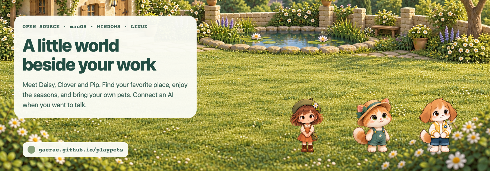
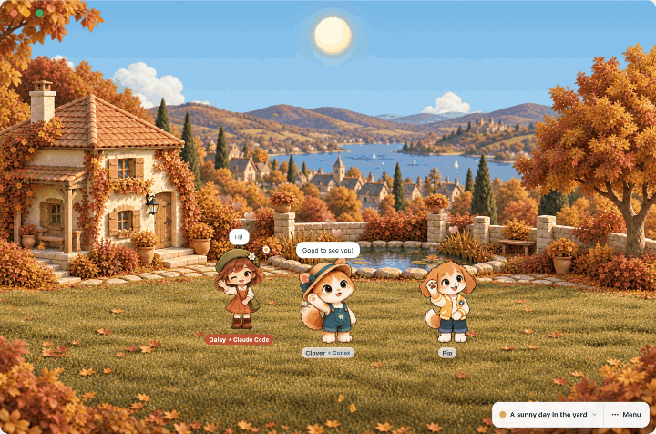

# PlayPets

[](https://playpets.gaerae.com/)

**A little yard for companions who talk to you—and each other.** Invite community pets, give each a personality, and choose a relationship: friend, partner, mentor or younger sibling. They wander, play and chat together while you work or unwind. Connect a local Ollama model, a signed-in Claude Code or Codex CLI, or an OpenAI-compatible server. PlayPets is a separate open-source app that reads compatible Codex pet files. You don't need Codex.

[Website](https://playpets.gaerae.com/) · [User guide](https://playpets.gaerae.com/guide/) · [Releases](https://playpets.gaerae.com/releases/) · [Developer docs](https://playpets.gaerae.com/dev/)

Korean: [Website](https://playpets.gaerae.com/ko/) · [User guide](https://playpets.gaerae.com/ko/guide/) · Japanese: [Website](https://playpets.gaerae.com/ja/) · [User guide](https://playpets.gaerae.com/ja/guide/) · Simplified Chinese: [Website](https://playpets.gaerae.com/zh-hans/) · [User guide](https://playpets.gaerae.com/zh-hans/guide/)

[](https://github.com/gaerae/playpets/actions/workflows/build.yml)   

Build a small community on your desktop, with a voice and a place for every friend.

| In PlayPets | Your choices |
|---|---|
| Companions | Daisy, Clover, Pip and Miso, or compatible community pet files |
| Appearance | Four illustrated starters with summer and winter outfits |
| Relationships | Friend, Partner, Dependable mentor or Playful younger sibling |
| Conversations | Chat with a friend, bring friends in, or let them talk together |
| AI connections | Signed-in Claude Code or Codex CLI, local Ollama, or an OpenAI-compatible server |
| Places to play | Four places and imported backgrounds, with season, time and weather controls; a resizable window and desktop mode |
| Coding company | Optional hooks and MCP for several coding agents |



- **Each friend, its own AI.** Chat through your signed-in Claude Code or Codex CLI subscription, within its usage allowance; paid extra usage can still apply. API-key CLI sign-in uses separate billing. Local Ollama models run on your computer without hosted inference fees; OpenAI and compatible APIs use the provider's billing. Give each friend a different AI and personality, and pick a relationship: Friend, Partner, Dependable mentor or Playful younger sibling.
- **Friends talk to each other.** When the AI brings another connected friend into the conversation, they answer in turn. Press **Let them chat** under Play → Group games and friends keep talking among themselves. You can also let them chat now and then on their own. In the yard it shows as speech bubbles.
- **Friends at work.** Claude Code, Gemini CLI and Cursor hooks, Codex notifications and MCP pass thinking, tool use, permission requests and completion on to a friend. Give each agent its own friend. Ask "What were you doing?" and the friend tells you about recent work.
- **A living yard.** Morning, day, evening and night follow the clock, the weather (clear, rain, snow) changes on its own, and at night the moon shows its real phase. You can also pick them yourself. Put down a treat and friends walk over to eat it. Leave them alone and they wander and talk to themselves.
- **Desktop mode.** Pets stroll around the desktop (on macOS, even over other apps in full screen).
- **Play together.** Hide and seek (find the friend whose name is called), parade, and tag.
- **Dig, grow and collect.** Dig for seeds, saplings and keepsakes, plant flowers and trees, and fish and catch bugs for the album. A tool stays in hand from one spot to the next; right-click bare ground to Dig here, or let idle friends dig on their own.
- **Four starter companions.** Daisy, Clover, Pip and Miso come with the app. Clover is the main mascot; all four have summer and winter outfits. They use the Codex pet format and are MIT licensed. Make your own with the [character studio](https://playpets.gaerae.com/guide/creator-kit), or create an importable place with the [background studio](https://playpets.gaerae.com/guide/background-kit).
- **Import community pets.** Paste the address of a pet page from OpenPets Registry (openpets.sh), Petdex, Codex PokéPets, Awesome Codex Pet (codexpet.top) or codex-pets.net, and the pet comes straight in. GitHub pet folder addresses and other sites built with codex-pet-share work too. Codex pets in `~/.codex/pets` load on their own. When a gallery adds a `playpets://import?url=<pet page>` link, one click brings the pet in.
- **A window beside your work.** Resize the yard down to 300 × 210: the dock folds away, a corner button that appears when you point at the window opens the same menu, and right-clicking a friend offers Talk, Play and Dig. Toggle Always on top independently; the app remembers the window position, size and pin setting.
- **Built with Tauri.** Uses Rust and the system webview. The yard redraws while something moves and rests when it is still.

## Install

- Download the macOS dmg, the Windows installer or portable zip, or the Linux deb or AppImage from [GitHub releases](https://github.com/gaerae/playpets/releases). The builds are not code-signed yet, so macOS or Windows may show a security warning. Read the [install guide](https://playpets.gaerae.com/guide/install) for the checks and options available on your system.
- To build it yourself, see [Development](#development) below.

## Getting started

1. Open **Friends & settings → Invite a friend** and invite a starter companion into the yard. Choose Daisy, Clover, Pip or Miso.
2. Connect an AI in **Settings → Friends & AI**, then click a friend's name tag to chat. Installed Claude Code and Codex are found automatically. Ollama and OpenAI-compatible servers just need an address.
3. In **Friend settings**, choose a personality, relationship and what the friend calls you. For company while coding, add your tool's hooks from **Settings → Coding tools**.

## Coding agent integration

In **Settings → Coding tools**, press "Copy settings" and paste. No Node.js needed: the app binary is the integration command.

| Tool | Where to paste | What it does |
|---|---|---|
| Claude Code (recommended) | `~/.claude/settings.json` | Reports every step through hooks |
| Codex CLI | `~/.codex/config.toml`, at the top | A note when a turn ends |
| Gemini CLI | `~/.gemini/settings.json` | Reports every step through hooks |
| Cursor | `~/.cursor/hooks.json` | Reports edits, commands and completion (observe-only hooks) |
| Other MCP tools | The tool's MCP settings | `set_pet_state`, `say`, `react`, `list_pets` |

```
playpets hook claude|gemini|cursor   # hooks (stdin JSON, always exit code 0; prints {} for Gemini and Cursor)
playpets hook codex <json>      # Codex notify
playpets mcp                    # MCP stdio server
playpets status <state> [message]   [--pet name|ID] [--bridge file]
playpets say <message>
playpets react <action>
playpets pets
playpets run -- <command>
```

The integration bridge stays on this computer (127.0.0.1, with token authentication). Hooks omit user prompts and tool inputs, but short completion and notification reports can contain work details, including code in an agent’s answer. Those reports can enter a friend’s conversation with your chosen AI provider. Review terminal and MCP messages before sending them; use a local model when those details need to stay on this computer.

## Data

- Data folder: macOS `~/Library/Application Support/app.playpets/`, Windows `%APPDATA%\app.playpets\`, Linux `~/.local/share/app.playpets/`. **Settings → About PlayPets → Open the data folder** opens it. It holds `state.json` (pets and settings), `bridge.json` (integration port and token), `pets/` (imported pets) and `builtin/` (starter pets). Change it with `PLAYPETS_DATA`.
- Updates: a newer version shows as the leftmost button in the yard controls, before the place selector (in a small window, a corner button that appears when you point at the window), and opens **Settings → App updates** ("What's new", "Later", "Install and restart" with progress). Check by hand there, with "Check for updates…" in the tray, or from the macOS menu bar; it also opens the notes of the version in use. The app checks quietly 20 seconds after it starts and every 6 hours, and installs only when you choose. It finds new versions through `latest.json` on GitHub releases and verifies them with the updater signing key before installing (from the first public release). After a successful update and restart, a brief notification confirms the installed version.
- Languages: Korean, English, Japanese and Simplified Chinese. The app follows the system language at first, and you can change it in **Settings → Language & startup** (`language` in `state.json`). Force a language with `PLAYPETS_LANG=ko|en|ja|zh-hans` (for testing). Strings live per language in `src/core/strings/<language>.js` for the page and `src-tauri/src/i18n/<language>.rs` for the backend (how to add one: `docs/how-to/add-a-language.md`). Tests catch any Korean left inside a module. The app speaks English to coding agents and the terminal.
- API keys are stored only in the OS secure storage (macOS Keychain, Windows Credential Manager, Linux Secret Service).
- Conversations stay in memory only and are gone when the app quits.

## Development

Developer docs start at [docs/README.md](docs/README.md) (architecture, standards, procedures, decision records). For a first setup, follow [Set up a development environment and run the app](docs/getting-started.md).

You need Rust (stable, 1.98 or later), Node.js 26, and the [Tauri prerequisites](https://v2.tauri.app/start/prerequisites/) (webkit2gtk and others on Linux).

| Task | Command |
|---|---|
| Install dependencies | `npm ci` |
| Unit tests (Rust and page) | `npm test` |
| Tidy / check code layout | `npm run format` / `npm run lint` (rustfmt, clippy, Oxlint, Biome) |
| Real-app E2E | `npm run test:e2e` (isolated data folder, its own test pet, fake AI server) |
| Live check against community sites | `npm run test:live-import` |
| Site dev server / build | `npm run site:dev` / `npm run site:build` (includes dead link check) |
| Site screenshots (macOS) | `npm run shots -- x.y.z` → `website/public/shots/` |
| Installer art | `npm run art` (DMG window, Windows installer pictures, Linux store screenshots) |
| macOS distribution file (dmg) | `npm run dist:mac` → `release/macos/` |
| Linux distribution and E2E | `npm run dist:linux` (Docker) → `release/linux/` (deb and AppImage, E2E under Xvfb) |
| Windows x64 distribution | `npm run dist:windows` (Docker) → `release/windows/` (MinGW cross build, NSIS installer, portable zip, and an MSIX signed with a test certificate in `msix-test/`) |
| Real runners for every OS | `.github/workflows/build.yml` (builds and E2E on macOS, Windows x64/arm64 and Linux x64/arm64 for every push to main and every PR; artifacts are in the run) |
| Release | `npm run release -- x.y.z`, then `git push origin HEAD vx.y.z`. `.github/workflows/release.yml` builds every environment and creates a GitHub release draft with the changelog section as notes (details in [Release a new version](docs/how-to/release.md)) |
| Distribution channels | When a release is published, `.github/workflows/distribute.yml` makes the winget manifest and the Homebrew cask, and with tokens also opens the winget PR and updates the tap ([Signing keys and secrets](docs/standards/keys-and-secrets.md)) |
| Redraw icons | `npm run icons` (`assets/icon.png` → every icon) |

```
src/              Page (HTML, CSS, JS, used as is with no build tool)
  index.html      Yard window · app.js entry point, render.js draws state, window.js window dragging, resizing and Always on top
  overlay.html    Desktop pet window · overlay/ its scripts and styles
  core/           Shared by both windows: state, sprites and animation, strings (i18n, strings), icons
  yard/           The yard: the painted scenery, friends, games, treats, the garden and its gifts,
                  fishing and bugs, closeness, seasonal events and the yard's sounds
  content/        What the yard is made of, as data: catalogue, composition, events · art/ its drawings
  panel/          Side panel: tabs, friends, chat, friend settings, AI connections, invite, settings
  styles/         Styles by area (base, shell, scenery, yard, panel, dialog, loaded in this order)
src-tauri/src/    App core (Rust)
  main.rs         Startup wiring · app.rs state (app/ loading, sprites) · commands.rs the COMMANDS table
  chat/           Chat, AI connections (subscription CLIs, HTTP), prompts
  pets/           Pet files, import from an address, friends in the yard
  agent/          Coding agents: the app's CLI mode (hooks, MCP) and the bridge
  desktop/        Desktop overlay and strolling
  i18n/           Backend strings tables
  *.rs            window, tray, system, store (data files), update, links (playpets://)
tests/            Page and script unit tests (*.test.mjs) and real-app E2E (e2e.mjs) · Rust tests live in each .rs file
packaging/        Distribution builds: macos (dmg), linux and windows (Docker, MSIX)
scripts/          Dev tools (release, distribution channels, site preparation, screenshots, installer art, OG images, mascot pets, measurement, icons)
assets/           Source art: icon, mascot, starter companions, banner and demo GIF
docs/             Developer docs (architecture, standards, how-to, decisions, design records)
website/          The site (VitePress): landing page, user guide and release pages in English (the root), Korean (ko/), Japanese (ja/) and Simplified Chinese (zh-hans/); developer docs are copied in from docs/ to dev/
```

### Platform notes
- The macOS overlay is turned into an NSPanel so it shows even over other apps in full screen (`src-tauri/src/desktop/overlay.rs`).
- A Windows build made with MinGW needs `WebView2Loader.dll` next to the exe (the installer includes it, and the portable zip ships it). An MSVC build links it statically, so the exe is all you need.
- Windows mixed DPI: cursor coordinates are converted using the scale of the monitor under the cursor.
- Windows MSIX: `packaging/windows/msix/AppxManifest.xml` (a full-trust desktop app plus the execution alias `playpets.exe`). When installed as a package, the agent integration settings point at the alias instead of the executable path. For a Store submission, build with your Partner Center publisher ID in `MSIX_PUBLISHER`. How to test-install: `release/windows/msix-test/README.txt`.
- The app identifier `app.playpets` becomes the data folder name, so it does not change after release.

## Contributing

[CONTRIBUTING.md](CONTRIBUTING.md) has the check order, [CODE_OF_CONDUCT.md](CODE_OF_CONDUCT.md) has the code of conduct, and [SECURITY.md](SECURITY.md) explains how to report a vulnerability.

## Changelog

[CHANGELOG.md](CHANGELOG.md) lists the changes users can see in each release.

## License

MIT. See [LICENSE](LICENSE). The pet mascot art (`assets/`) is under the same license. Community pets you import belong to their creators, and their source is saved alongside them in `pet.json`.

## Trademarks

PlayPets is not affiliated with or endorsed by OpenAI. Codex is a trademark of OpenAI, and Claude, Gemini, Cursor and Ollama are trademarks of their respective companies. This app only reads the Codex pet file format.
