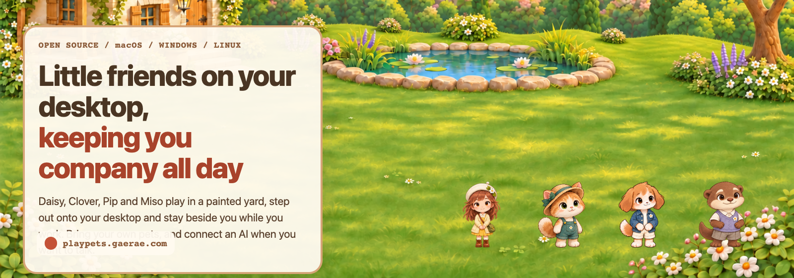
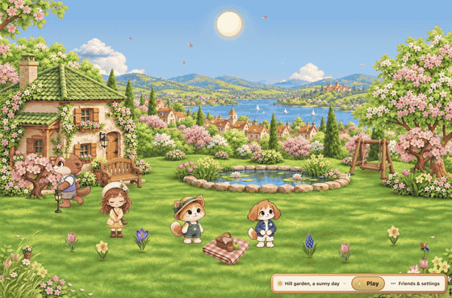
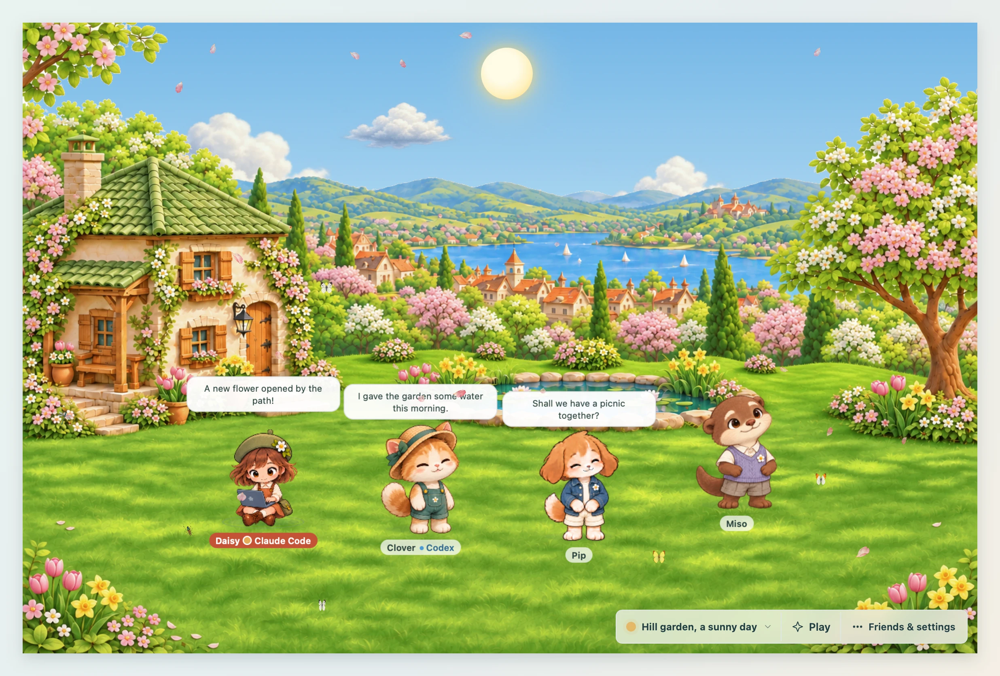
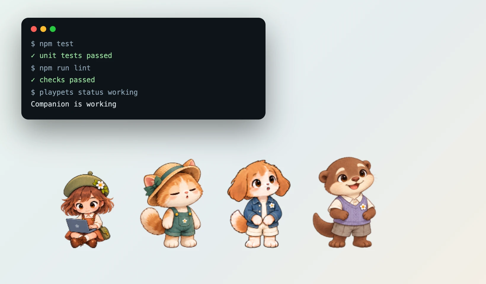
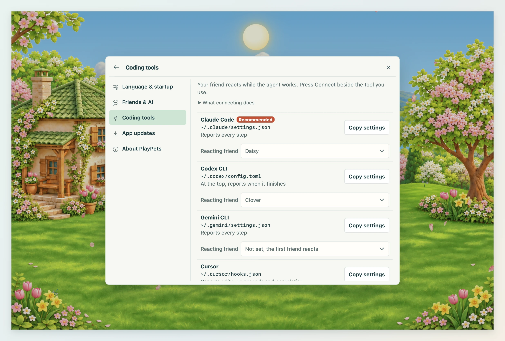

<div align="center">

<a href="https://playpets.gaerae.com/"></a>

# PlayPets

**A desktop companion: pet friends live in a painted yard, step out onto your desktop to play, and keep you company all day, coding agents included.**

[](https://github.com/gaerae/playpets/releases/latest)
[](https://github.com/gaerae/playpets/releases)
[](LICENSE)


**[Download](https://playpets.gaerae.com/#download)** · **[User guide](https://playpets.gaerae.com/guide/)** · **[Studio](https://playpets.gaerae.com/guide/creator-kit)** · **[Releases](https://playpets.gaerae.com/releases/)** · **[Developer docs](https://playpets.gaerae.com/dev/)**

Site in [English](https://playpets.gaerae.com/), [Korean](https://playpets.gaerae.com/ko/), [Japanese](https://playpets.gaerae.com/ja/) and [Simplified Chinese](https://playpets.gaerae.com/zh-hans/)



</div>

## What makes it special
- **A painted yard to look around.** Hill garden, Wild garden, Lakeside cottage and Garden workshop change with the season, the time and the weather. Friends dig, plant, fish, play four games (one only in winter) and fill a 213-entry album with you.
- **They step out onto your desktop.** Send a friend, a gift, a flower or a tree out from its right-click menu. Friends stroll your screen and visit what you put there, on macOS over full-screen apps too.
- **Always on, never in the way.** PlayPets waits in the tray, can start at login, and draws only while something moves.
- **They talk, with you and with each other,** through the AI you pick for each friend: a signed-in Claude Code or Codex CLI, local Ollama, an OpenAI or Grok key, or an OpenAI-compatible server. Up to 12 friends at once.
- **They keep your coding agent company.** Claude Code, Codex, Gemini CLI, Cursor, Grok Build, Qoder, Kimi Code and other MCP tools: a friend works while the agent works, comes forward when it needs your approval and cheers when it is done.
- **Bring your own friends.** Codex pet files work as they are, and the studio gives your AI tool a kit to draw a new friend or a new place.

| Friends talk among themselves | Out on your desktop while you code | A friend for each coding agent |
|---|---|---|
|  |  |  |

## Install

| System | Get it |
|---|---|
| macOS (Apple Silicon and Intel) | Homebrew (below), or `PlayPets_<version>_macos-universal.dmg` from [releases](https://github.com/gaerae/playpets/releases/latest) |
| Windows x64 / ARM | [Microsoft Store](https://apps.microsoft.com/detail/9NSKXQ6R187M) or winget (below), or `…_windows-x64-setup.exe` / `…_windows-arm64-setup.exe` from [releases](https://github.com/gaerae/playpets/releases/latest) |
| Linux x64 / arm64 | `.deb` (Debian, Ubuntu) or `.AppImage` (needs FUSE 2) from [releases](https://github.com/gaerae/playpets/releases/latest) |

```bash
brew install gaerae/tap/playpets                     # macOS
winget install --id 9NSKXQ6R187M --source msstore    # Windows
```

- The macOS app is signed and notarized. The Store and winget packages are signed by Microsoft and need Windows 10 version 2004 or later.
- The Windows installer from GitHub is not code-signed yet, so SmartScreen may warn: [how to get past it](https://playpets.gaerae.com/guide/install#installer-from-github).
- Everything else, including updates and the data folder: the [install guide](https://playpets.gaerae.com/guide/install).

## First steps
1. Open **Friends & settings → Invite a friend** and pick Daisy, Clover, Pip or Miso.
2. Connect an AI in **Settings → Friends & AI**. Installed Claude Code and Codex are found for you.
3. Point at a friend and click its name tag to chat.
4. Optional: in **Settings → Coding tools**, press **Connect** next to your coding agent.

More in the [user guide](https://playpets.gaerae.com/guide/): [chat and AI billing](https://playpets.gaerae.com/guide/chat), [the yard and its games](https://playpets.gaerae.com/guide/play), [the desktop](https://playpets.gaerae.com/guide/desktop), [coding agents](https://playpets.gaerae.com/guide/agents) and [importing pets](https://playpets.gaerae.com/guide/import).

## Privacy
- Pets and settings stay in a data folder on your computer; API keys go only to the system's secure storage.
- Conversations stay in memory and are gone when the app quits.
- The coding-agent bridge stays on this computer (127.0.0.1, with a token), and hooks leave out your prompts and tool inputs. Short completion reports can still reach your chosen AI in a conversation; use a local model to keep them on this computer.
- Details: the [privacy policy](https://playpets.gaerae.com/privacy).

## Development
- Rust stable 1.99+, Node.js 26.12.1+ and the [Tauri prerequisites](https://v2.tauri.app/start/prerequisites/).
- `pnpm install --frozen-lockfile`, then `pnpm test` and `pnpm run lint`; `pnpm run test:e2e` runs the real app.
- Start with [Set up a development environment](docs/getting-started.md); architecture, standards and the coding-agent CLI and MCP specs are in the [developer docs](docs/README.md).
- Before a PR: [CONTRIBUTING.md](CONTRIBUTING.md). Also [CODE_OF_CONDUCT.md](CODE_OF_CONDUCT.md), [SECURITY.md](SECURITY.md) and [CHANGELOG.md](CHANGELOG.md).
- Found a bug or have an idea? [Open an issue](https://github.com/gaerae/playpets/issues), or read the [FAQ](https://playpets.gaerae.com/guide/faq) first.

## License and trademarks
- MIT ([LICENSE](LICENSE)), including the pet mascot art in `assets/`.
- Imported community pets belong to their creators; the source is saved with each in `pet.json`.
- PlayPets is not affiliated with or endorsed by OpenAI. ChatGPT and Codex are trademarks of OpenAI. Claude, Gemini, Cursor, Grok and Ollama are trademarks of their companies. PlayPets only reads the Codex pet file format.
