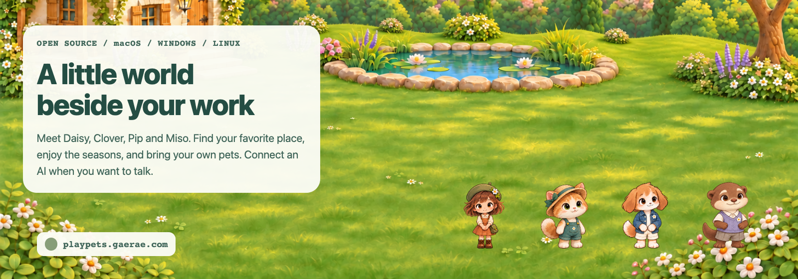
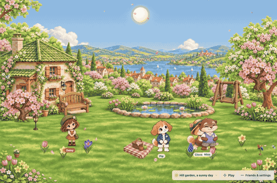
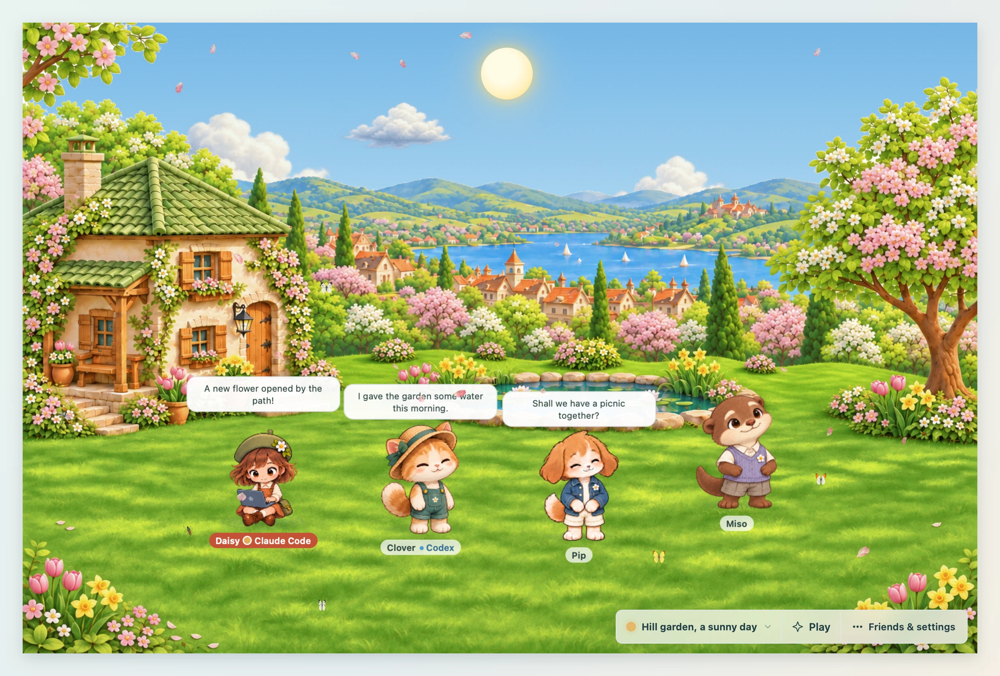
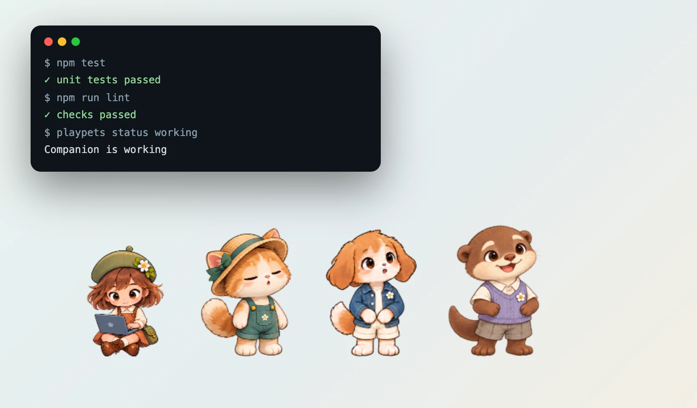
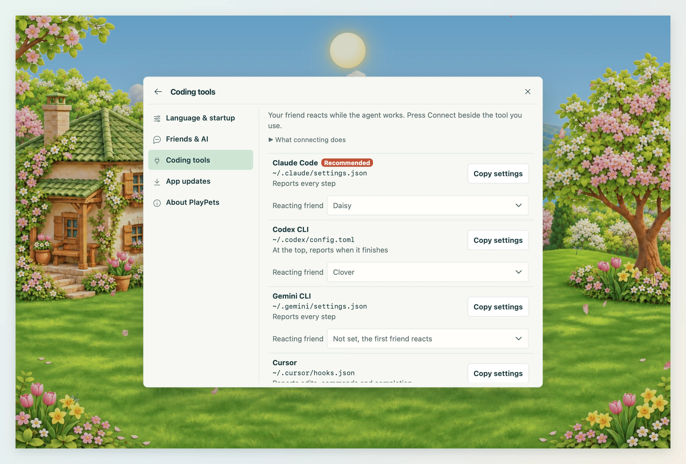

<div align="center">

<a href="https://playpets.gaerae.com/"></a>

# PlayPets

**Pet friends that live on your desktop: four come with the app, any Codex pet can join them, and up to 12 talk to each other and cheer on your coding agent.**

[](https://github.com/gaerae/playpets/releases/latest)
[](https://github.com/gaerae/playpets/releases)
[](LICENSE)


[](https://playpets.gaerae.com/#download)
[](https://apps.microsoft.com/detail/9NSKXQ6R187M)
[](https://github.com/gaerae/playpets/releases/latest)
[](https://playpets.gaerae.com/#download)

**[Website](https://playpets.gaerae.com/)** · **[User guide](https://playpets.gaerae.com/guide/)** · **[Install guide](https://playpets.gaerae.com/guide/install)** · **[Releases](https://playpets.gaerae.com/releases/)** · **[Developer docs](https://playpets.gaerae.com/dev/)**

Site in: [English](https://playpets.gaerae.com/) · [Korean](https://playpets.gaerae.com/ko/) · [Japanese](https://playpets.gaerae.com/ja/) · [Simplified Chinese](https://playpets.gaerae.com/zh-hans/)



</div>

## Why PlayPets
- 🐾 Reads Codex pet files (the custom pets made for ChatGPT and Codex) as they are: every action, and the sixteen look directions when the sheet has them. Codex is not needed.
- 👥 Up to 12 friends at once, in the yard and out on your desktop, one by one, with gifts, flowers and trees from the yard to decorate it. Keep your pet in the ChatGPT desktop app too: both read the same pet files.
- 💬 They chat with you, and with each other, through the AI you pick.
- 🧑‍💻 They react to Claude Code, Codex, Gemini CLI, Cursor, Grok Build, Qoder, Kimi Code and other MCP tools.
- 🏡 A yard of their own: Hill garden, Wild garden, Lakeside cottage, Garden workshop or your own backgrounds, gifts like a swing or a pond, four games (one only in winter), a garden, fishing and a 169-entry album.
- 🌱 The four starter pets also dig, plant, fish and change clothes with the seasons.
- 🔓 Free and open source (MIT) for macOS, Windows and Linux.

| Friends talk among themselves | Out on your desktop while you code | A friend for each coding agent |
|---|---|---|
|  |  |  |

## Features

| Area | What you get |
|---|---|
| Companions | Daisy, Clover (main mascot), Pip and Miso, with summer and winter outfits; or community pet files |
| Relationships | Friend, Partner, Dependable mentor, Playful younger sibling |
| Conversations | Chat with one friend, bring others in, or let them talk among themselves |
| AI connections | Signed-in Claude Code or Codex CLI, local Ollama, an OpenAI or Grok (xAI) API key, or an OpenAI-compatible server; one AI per friend |
| Places | Hill garden, Wild garden, Lakeside cottage, Garden workshop and imported backgrounds; season, time and weather controls |
| Play | Hide and seek, parade, tag and, in winter, a snowman |
| Garden and album | Dig for seeds, saplings and keepsakes; plant; fish and catch bugs; fill a 169-entry album |
| Desktop mode | Send friends, gifts, flowers and trees out one by one from their right-click menu; friends stroll and visit them (on macOS, over full-screen apps too) |
| Coding company | Hooks and MCP for Claude Code, Codex, Gemini CLI, Cursor, Grok Build, Qoder, Kimi Code and other MCP tools |
| Languages | English, Korean, Japanese, Simplified Chinese |

More in the [user guide](https://playpets.gaerae.com/guide/): [chat and AI billing](https://playpets.gaerae.com/guide/chat), [the yard and its games](https://playpets.gaerae.com/guide/play), [the desktop](https://playpets.gaerae.com/guide/desktop), [importing community pets](https://playpets.gaerae.com/guide/import) and the [character](https://playpets.gaerae.com/guide/creator-kit) and [background](https://playpets.gaerae.com/guide/background-kit) studios.

## Install

| System | Get it |
|---|---|
| macOS (Apple Silicon and Intel) | `PlayPets_<version>_macos-universal.dmg` from [releases](https://github.com/gaerae/playpets/releases/latest), or Homebrew (below) |
| Windows x64 / ARM | [Microsoft Store](https://apps.microsoft.com/detail/9NSKXQ6R187M) or winget (below), or `PlayPets_<version>_windows-x64-setup.exe` / `…_windows-arm64-setup.exe` from [releases](https://github.com/gaerae/playpets/releases/latest) |
| Linux x64 / arm64 | `.deb` (Debian, Ubuntu) or `.AppImage` (needs FUSE 2) |

```bash
# macOS
brew install gaerae/tap/playpets
# Windows
winget install --id 9NSKXQ6R187M --source msstore
```

- From 1.3.0 the macOS app is signed and notarized. The Windows installer from GitHub is not code-signed yet, so SmartScreen may warn ([how to install it through the warning](https://playpets.gaerae.com/guide/install#installer-from-github)); the Microsoft Store and winget packages are signed by Microsoft.
- The [install guide](https://playpets.gaerae.com/guide/install) covers those warnings and Linux notes.
- The Microsoft Store package needs Windows 10 version 2004 or later.
- To build from source, see [Development](#development).

## Getting started
1. Open **Friends & settings → Invite a friend** and pick Daisy, Clover, Pip or Miso.
2. Connect an AI in **Settings → Friends & AI**.
   - Installed Claude Code and Codex are found automatically.
   - Ollama and OpenAI-compatible servers need a model name; a compatible server also needs its address, and an API key only if it asks for one.
3. Click a friend's name tag to chat.
4. In **Friend settings**, choose a personality, a relationship and what the friend calls you.
5. Optional: add your coding tool's hooks from **Settings → Coding tools**.

## Coding agent integration
- In **Settings → Coding tools**, press **Connect**: PlayPets asks, then adds its hook to that tool's settings file and keeps a backup beside it.
- **Disconnect** takes out only PlayPets' entries; **Copy settings** still gives the snippet to paste yourself.
- No Node.js needed: the app binary is the integration command.

| Tool | Where to paste | What it does |
|---|---|---|
| Claude Code (recommended) | `~/.claude/settings.json` | Reports every step through hooks |
| Codex CLI | `~/.codex/config.toml`, at the top | A note when a turn ends |
| Gemini CLI | `~/.gemini/settings.json` | Reports every step through hooks |
| Cursor | `~/.cursor/hooks.json` | Reports edits, commands and completion (observe-only hooks) |
| Grok Build | `~/.grok/hooks/playpets.json`, a new file | Reports every step through hooks |
| Qoder | `~/.qoder/settings.json` | Reports every step through hooks |
| Kimi Code | `~/.kimi-code/config.toml`, at the end | Reports every step through hooks |
| Other MCP tools | The tool's MCP settings | `set_pet_state`, `say`, `react`, `list_pets` |

<details>
<summary>Terminal commands</summary>

```
playpets hook claude|gemini|cursor|grok|qoder|kimi   # hooks (stdin JSON, always exit code 0; prints {} for Gemini and Cursor)
playpets hook codex <json>      # Codex notify
playpets mcp                    # MCP stdio server
playpets status <state> [message]   [--pet name|ID] [--bridge file]
playpets say <message>
playpets react <action>
playpets pets
playpets run -- <command>
```

</details>

> [!NOTE]
> - The bridge stays on this computer: 127.0.0.1, with token authentication.
> - Hooks leave out your prompts and tool inputs.
> - Short completion and notification reports can still hold work details, including code in an agent's answer. They can reach your chosen AI provider in a friend's conversation.
> - Review terminal and MCP messages before sending. Use a local model to keep those details on this computer.

## Privacy, updates and languages
- Pets and settings stay in a data folder on your computer ([data folder](https://playpets.gaerae.com/guide/settings#data-folder)); API keys go only to the system's secure storage.
- Conversations stay in memory and are gone when the app quits. See the [privacy policy](https://playpets.gaerae.com/privacy).
- The app looks for updates on its own and installs one only when you choose; each is checked against the updater signing key. The Store version updates through the Store ([app updates](https://playpets.gaerae.com/guide/settings#app-updates)).
- English, Korean, Japanese and Simplified Chinese, following the system language; change it in **Settings → Language & startup**.

## Development
- Needs Rust stable 1.99+, Node.js 26.12.1+ and the [Tauri prerequisites](https://v2.tauri.app/start/prerequisites/).
- First setup and running the app: [Set up a development environment](docs/getting-started.md).
- `pnpm install --frozen-lockfile`, then `pnpm test` and `pnpm run lint`; `pnpm run test:e2e` runs the real app.
- Architecture, standards, every command and workflow, and the repository map: [developer docs](docs/README.md).

## Contributing
- [CONTRIBUTING.md](CONTRIBUTING.md): the check order.
- [CODE_OF_CONDUCT.md](CODE_OF_CONDUCT.md): the code of conduct.
- [SECURITY.md](SECURITY.md): how to report a vulnerability.
- [CHANGELOG.md](CHANGELOG.md): what users see change in each release.
- Found a bug or have an idea? [Open an issue](https://github.com/gaerae/playpets/issues). Questions people often ask are in the [FAQ](https://playpets.gaerae.com/guide/faq).

## License
- MIT ([LICENSE](LICENSE)), including the pet mascot art in `assets/`.
- Imported community pets belong to their creators; the source is saved with each in `pet.json`.

## Trademarks
- PlayPets is not affiliated with or endorsed by OpenAI.
- ChatGPT and Codex are trademarks of OpenAI. Claude, Gemini, Cursor, Grok and Ollama are trademarks of their companies.
- PlayPets only reads the Codex pet file format.
