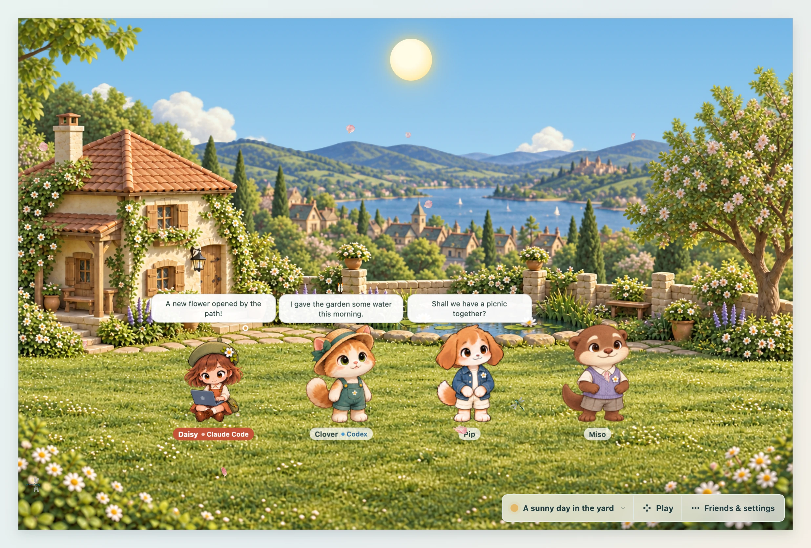
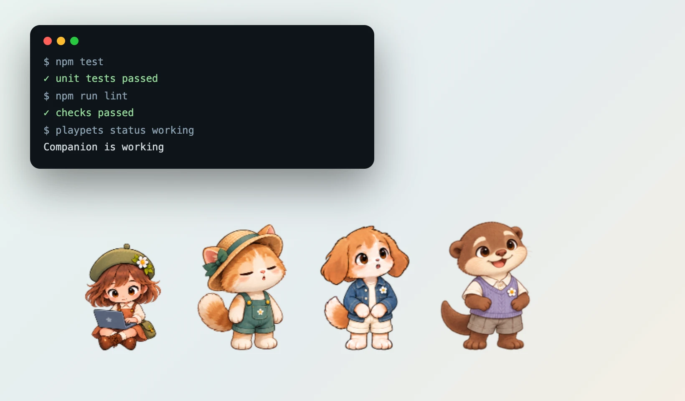
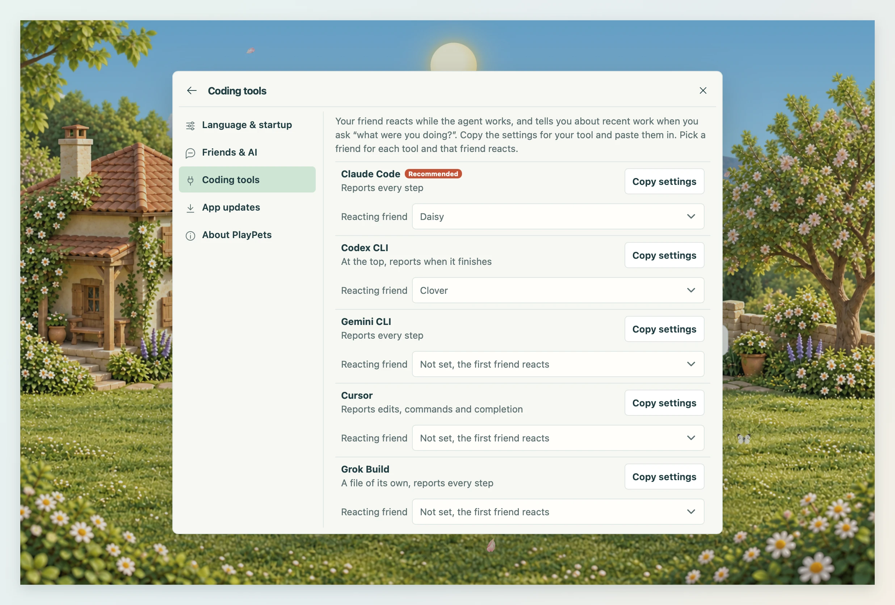

<div align="center">

<a href="https://playpets.gaerae.com/"></a>

# PlayPets

**Your Codex pets, together on your desktop: up to 12 at once, talking to each other and cheering on your coding agent.**

[](https://github.com/gaerae/playpets/releases/latest)
[](https://github.com/gaerae/playpets/releases)
[](https://github.com/gaerae/playpets/actions/workflows/build.yml)
[](LICENSE)


[](https://github.com/gaerae/playpets/releases/latest)
[](https://apps.microsoft.com/detail/9NSKXQ6R187M)
[](https://github.com/gaerae/playpets/releases/latest)

**[Website](https://playpets.gaerae.com/)** · **[User guide](https://playpets.gaerae.com/guide/)** · **[Install guide](https://playpets.gaerae.com/guide/install)** · **[Releases](https://playpets.gaerae.com/releases/)** · **[Developer docs](https://playpets.gaerae.com/dev/)**

Site in: [English](https://playpets.gaerae.com/) · [Korean](https://playpets.gaerae.com/ko/) · [Japanese](https://playpets.gaerae.com/ja/) · [Simplified Chinese](https://playpets.gaerae.com/zh-hans/)


</div>

## Why PlayPets
- 🐾 Reads Codex pet files (the custom pets made for ChatGPT and Codex) as they are: every action, and the sixteen look directions when the sheet has them. Codex is not needed.
- 👥 Up to 12 friends at once, in the yard and out on your desktop. Keep your pet in the ChatGPT desktop app too: both read the same pet files.
- 💬 They chat with you, and with each other, through the AI you pick.
- 🧑‍💻 They react to Claude Code, Codex, Gemini CLI, Cursor and other MCP tools.
- 🏡 A yard of their own: four places or your own backgrounds, gifts like a swing or a pond, three games, a garden, fishing and an album.
- 🌱 The four starter pets also dig, plant, fish and change clothes with the seasons.
- 🔓 Free and open source (MIT) for macOS, Windows and Linux.

| Friends talk among themselves | Out on your desktop while you code | A friend for each coding agent |
|---|---|---|
|  |  |  |

## Features

| Area | What you get |
|---|---|
| Companions | Daisy, Clover (main mascot), Pip and Miso, with summer and winter outfits; or community pet files |
| Relationships | Friend, Partner, Dependable mentor, Playful younger sibling |
| Conversations | Chat with one friend, bring others in, or let them talk among themselves |
| AI connections | Signed-in Claude Code or Codex CLI, local Ollama, an OpenAI or Grok (xAI) API key, or an OpenAI-compatible server; one AI per friend |
| Places | Four places and imported backgrounds; season, time and weather controls |
| Play | Hide and seek, parade, tag |
| Garden and album | Dig for seeds, saplings and keepsakes; plant; fish and catch bugs |
| Desktop mode | Pets stroll the desktop (on macOS, over full-screen apps too) |
| Coding company | Hooks and MCP for Claude Code, Codex, Gemini CLI, Cursor, Grok Build and other MCP tools |
| Languages | English, Korean, Japanese, Simplified Chinese |

<details>
<summary>More about each feature</summary>

- **AI and billing**
  - Claude Code or Codex CLI: uses your subscription allowance; paid extra usage can still apply.
  - API-key CLI sign-in: billed separately.
  - Ollama: runs on your computer, no hosted inference fees.
  - OpenAI, xAI (Grok) and compatible APIs: the provider's billing.
- **Friends talk to each other**
  - When the AI brings in another connected friend, they answer in turn.
  - **Let them chat** under **Play → Group games** keeps them talking.
  - They can also chat now and then on their own; the yard shows speech bubbles.
- **Friends at work**
  - Hooks, Codex notifications and MCP pass on thinking, tool use, permission requests and completion.
  - Give each agent its own friend.
  - Ask "What were you doing?" for a summary of recent work.
- **A living yard**
  - Morning, day, evening and night follow the clock; the weather (clear, rain, snow) changes on its own.
  - The moon shows its real phase at night. You can set all of these yourself.
  - Put down a treat and friends walk over to eat it.
  - Left alone, friends wander, talk to themselves, and may dig.
- **Garden**
  - A tool stays in hand from one spot to the next.
  - Right-click bare ground for **Dig here**.
- **Make your own**
  - Pets: the [character studio](https://playpets.gaerae.com/guide/creator-kit).
  - Places: the [background studio](https://playpets.gaerae.com/guide/background-kit).
  - Starter pets use the Codex pet format and are MIT licensed.
- **Import community pets**
  - Paste a pet page address from OpenPets Registry (openpets.sh), Petdex, Codex PokéPets, Awesome Codex Pet (codexpet.top) or codex-pets.net.
  - GitHub pet folders and other codex-pet-share sites work too.
  - Pets in `~/.codex/pets` load on their own.
  - A gallery link `playpets://import?url=<pet page>` imports in one click.
- **A window beside your work**
  - Resizes down to 300 × 210; the dock folds into a corner button that appears on hover.
  - Right-click a friend for **Talk**, **Play** and **Dig**.
  - **Always on top** toggles on its own. Position, size and pin are remembered.
- **Light on resources**
  - Tauri: Rust and the system webview.
  - The yard redraws only while something moves.

</details>

## Install

| System | Get it |
|---|---|
| macOS (Apple Silicon and Intel) | `PlayPets_<version>_macos-universal.dmg` from [releases](https://github.com/gaerae/playpets/releases/latest), or Homebrew (below) |
| Windows x64 / ARM | [Microsoft Store](https://apps.microsoft.com/detail/9NSKXQ6R187M) or winget (below), or `PlayPets_<version>_windows-x64-setup.exe` / `…_windows-arm64-setup.exe` from [releases](https://github.com/gaerae/playpets/releases/latest) |
| Linux x64 / arm64 | `.deb` (Debian, Ubuntu) or `.AppImage` (needs FUSE 2) |

```bash
# macOS
brew install gaerae/tap/playpets
# Windows
winget install --id 9NSKXQ6R187M --source msstore
```

- From 1.3.0 the macOS app is signed and notarized. The Windows installer from GitHub is not code-signed yet, so SmartScreen may warn; the Microsoft Store and winget packages are signed by Microsoft.
- The [install guide](https://playpets.gaerae.com/guide/install) covers those warnings and Linux notes.
- To build from source, see [Development](#development).

## Getting started
1. Open **Friends & settings → Invite a friend** and pick Daisy, Clover, Pip or Miso.
2. Connect an AI in **Settings → Friends & AI**.
   - Installed Claude Code and Codex are found automatically.
   - Ollama and OpenAI-compatible servers need only an address.
3. Click a friend's name tag to chat.
4. In **Friend settings**, choose a personality, a relationship and what the friend calls you.
5. Optional: add your coding tool's hooks from **Settings → Coding tools**.

## Coding agent integration
- In **Settings → Coding tools**, press **Copy settings** and paste.
- No Node.js needed: the app binary is the integration command.

| Tool | Where to paste | What it does |
|---|---|---|
| Claude Code (recommended) | `~/.claude/settings.json` | Reports every step through hooks |
| Codex CLI | `~/.codex/config.toml`, at the top | A note when a turn ends |
| Gemini CLI | `~/.gemini/settings.json` | Reports every step through hooks |
| Cursor | `~/.cursor/hooks.json` | Reports edits, commands and completion (observe-only hooks) |
| Grok Build | `~/.grok/hooks/playpets.json`, a new file | Reports every step through hooks |
| Other MCP tools | The tool's MCP settings | `set_pet_state`, `say`, `react`, `list_pets` |

<details>
<summary>Terminal commands</summary>

```
playpets hook claude|gemini|cursor|grok   # hooks (stdin JSON, always exit code 0; prints {} for Gemini and Cursor)
playpets hook codex <json>      # Codex notify
playpets mcp                    # MCP stdio server
playpets status <state> [message]   [--pet name|ID] [--bridge file]
playpets say <message>
playpets react <action>
playpets pets
playpets run -- <command>
```

</details>

> [!NOTE]
> - The bridge stays on this computer: 127.0.0.1, with token authentication.
> - Hooks leave out your prompts and tool inputs.
> - Short completion and notification reports can still hold work details, including code in an agent's answer. They can reach your chosen AI provider in a friend's conversation.
> - Review terminal and MCP messages before sending. Use a local model to keep those details on this computer.

## Data and privacy
- Pets and settings stay in a data folder on your computer: **Settings → About PlayPets → Open the data folder**. `PLAYPETS_DATA` moves it.
- API keys go only to the system's secure storage: macOS Keychain, Windows Credential Manager, Linux Secret Service.
- Conversations stay in memory and are gone when the app quits.
- More: [data folder](https://playpets.gaerae.com/guide/settings#data-folder) · [privacy policy](https://playpets.gaerae.com/privacy).

## Updates
- The app checks 20 seconds after start, then every 6 hours, and installs only when you choose.
- A new version shows as a yard button that opens **Settings → App updates** with what's new.
- Each update is verified with the updater signing key before install.
- The Microsoft Store version updates through the Store.
- More: [app updates](https://playpets.gaerae.com/guide/settings#app-updates).

## Languages
- English, Korean, Japanese and Simplified Chinese. The app follows the system language; change it in **Settings → Language & startup**.
- Coding agents and the terminal get English.
- To add a language: [docs/how-to/add-a-language.md](docs/how-to/add-a-language.md).

## Development
- Start at [docs/README.md](docs/README.md): architecture, standards, how-tos, decision records.
- First setup: [Set up a development environment and run the app](docs/getting-started.md).
- Needs: Rust stable 1.99+, Node.js 26.12.1+, the [Tauri prerequisites](https://v2.tauri.app/start/prerequisites/) (webkit2gtk and others on Linux).

| Task | Command |
|---|---|
| Install dependencies | `npm ci` |
| Unit tests (Rust and page) | `npm test` |
| Format / check | `npm run format` / `npm run lint` (rustfmt, clippy, Oxlint, Biome) |
| Real-app E2E | `npm run test:e2e` (isolated data folder, own test pet, fake AI server) |
| Live check against community sites | `npm run test:live-import` |
| Site dev server / build | `npm run site:dev` / `npm run site:build` (fails on a dead link) |
| Site screenshots (macOS) | `npm run shots -- x.y.z` → `website/public/shots/` |
| Installer art | `npm run art` (DMG window, Windows installer pictures, Linux store screenshots) |
| macOS dmg | `npm run dist:mac` → `release/macos/` |
| Linux packages and E2E | `npm run dist:linux` (Docker) → `release/linux/` (deb, AppImage, E2E under Xvfb) |
| Windows x64 packages | `npm run dist:windows` (Docker) → `release/windows/` (MinGW cross build, NSIS installer, portable zip, MSIX signed with a test certificate in `msix-test/`) |
| Redraw icons | `npm run icons` (`assets/icon.png` → every icon) |

| Workflow | What it does |
|---|---|
| `.github/workflows/build.yml` | Builds and E2E on macOS, Windows x64/arm64, Linux x64/arm64 for every push to `main` and every PR; artifacts in the run |
| `.github/workflows/release.yml` | After `npm run release -- x.y.z` and `git push origin HEAD vx.y.z`: builds every platform, drafts a GitHub release with the changelog section ([Release a new version](docs/how-to/release.md)) |
| `.github/workflows/distribute.yml` | On a published release: makes the winget manifest and the Homebrew cask; with tokens, opens the winget PR and updates the tap ([Signing keys and secrets](docs/standards/keys-and-secrets.md)) |

<details>
<summary>Repository map</summary>

```
src/              Page (HTML, CSS, JS, used as is with no build tool)
  index.html      Yard window · app.js entry point, render.js draws state, window.js window dragging, resizing and Always on top
  overlay.html    Desktop pet window · overlay/ its scripts and styles
  core/           Shared by both windows: state, sprites and animation, strings (i18n, strings), icons
  yard/           The yard: the painted scenery, friends, games, treats, the garden and its gifts,
                  fishing and bugs, closeness, seasonal events and the yard's sounds
  content/        What the yard is made of, as data: catalogue, composition, events · art/ its drawings
  panel/          Side panel: tabs, friends, chat, friend settings, AI connections, invite, settings
  styles/         Styles by area (base, shell, scenery, yard, panel, dialog, loaded in this order)
src-tauri/src/    App core (Rust)
  main.rs         Startup wiring · app.rs state (app/ loading, sprites) · commands.rs the COMMANDS table
  chat/           Chat, AI connections (subscription CLIs, HTTP), prompts
  pets/           Pet files, import from an address, friends in the yard
  agent/          Coding agents: the app's CLI mode (hooks, MCP) and the bridge
  desktop/        Desktop overlay and strolling
  i18n/           Backend strings tables
  *.rs            window, tray, system, store (data files), update, links (playpets://)
tests/            Page and script unit tests (*.test.mjs) and real-app E2E (e2e.mjs) · Rust tests live in each .rs file
packaging/        Distribution builds: macos (dmg), linux and windows (Docker, MSIX)
scripts/          Dev tools (release, distribution channels, site preparation, screenshots, installer art, OG images, mascot pets, measurement, icons)
assets/           Source art: icon, mascot, starter companions, banner and demo GIF
docs/             Developer docs (architecture, standards, how-to, decisions, design records)
website/          The site (VitePress): landing page, user guide and release pages in English (the root), Korean (ko/), Japanese (ja/) and Simplified Chinese (zh-hans/); developer docs are copied in from docs/ to dev/
```

</details>

### Platform notes
- macOS: the overlay becomes an NSPanel so it shows over full-screen apps (`src-tauri/src/desktop/overlay.rs`).
- Windows, MinGW build: needs `WebView2Loader.dll` next to the exe (the installer and the portable zip include it). An MSVC build links it statically.
- Windows, mixed DPI: cursor coordinates use the scale of the monitor under the cursor.
- Windows MSIX: `packaging/windows/msix/AppxManifest.xml`.
  - A full-trust desktop app plus the execution alias `playpets.exe`.
  - Installed as a package, agent settings point at the alias, not the exe path.
  - Store build: set your Partner Center publisher ID in `MSIX_PUBLISHER`.
  - Test install: `release/windows/msix-test/README.txt`.
- The app identifier `app.playpets` is the data folder name; it never changes after release.

## Contributing
- [CONTRIBUTING.md](CONTRIBUTING.md): the check order.
- [CODE_OF_CONDUCT.md](CODE_OF_CONDUCT.md): the code of conduct.
- [SECURITY.md](SECURITY.md): how to report a vulnerability.
- [CHANGELOG.md](CHANGELOG.md): what users see change in each release.

## License
- MIT ([LICENSE](LICENSE)), including the pet mascot art in `assets/`.
- Imported community pets belong to their creators; the source is saved with each in `pet.json`.

## Trademarks
- PlayPets is not affiliated with or endorsed by OpenAI.
- ChatGPT and Codex are trademarks of OpenAI. Claude, Gemini, Cursor, Grok and Ollama are trademarks of their companies.
- PlayPets only reads the Codex pet file format.
