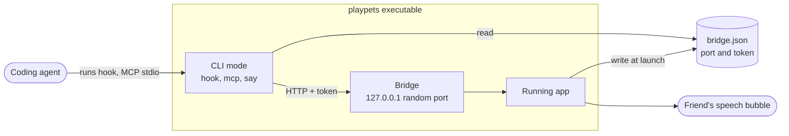

# Architecture: coding agent integration

## Scope
This describes the current structure of the path through which coding agents (Claude Code, Codex, Gemini CLI, Cursor, and tools that use MCP) tell PlayPets friends their status. It is for people adding a new integration or building tools on the agent side. The architecture of the whole app is in [PlayPets app architecture](architecture.md).

The integration stays inside this computer. What you type into the agent and your code are not sent to friends; only states and short sentences are.

## Diagram
A container-level diagram. It shows everything from what the agent runs to what appears on the friend.

## Components
| Component | Location | Responsibility |
|---|---|---|
| CLI mode | `src-tauri/src/agent/cli.rs` | Running the app executable with a command argument (`hook`, `mcp`, `status`, `say`, `react`, `pets`, `run`) runs it in this mode with no window. Node.js is not needed |
| Hook translation | `agent::cli::hook_event` | Turns each agent's hook payload into a state and a code. Prompts and tool inputs are not sent |
| MCP server | `agent::cli::mcp_reply` | An MCP server that takes JSON-RPC one line at a time over standard input and output. Four tools |
| Bridge | `src-tauri/src/agent/bridge.rs` | The HTTP server inside the app. A random port on `127.0.0.1`, a token check on every request, browser requests refused |
| Event handling | `src-tauri/src/agent/mod.rs` | Turns codes into sentences in the current language, remembers them as recent activity, and shows them as the friend's status |
| Settings snippets | `connection_snippet` in `agent/snippets.rs` (the agent list is in `agent/kinds.rs`) | The Settings tab's "Copy settings" builds the snippet to paste into each agent's settings file. It contains the executable path and the `bridge.json` path, and if a friend was picked for that agent in the Settings tab, it adds `--pet <friend id>` (`PLAYPETS_PET` for MCP). The assignment is saved in `AppData.agent_pets` and removed when that friend is sent away |

## Data flow
1. **When the app launches:** The bridge opens on `127.0.0.1:0`, and the app writes the port it got and a new token (64 random characters) to `bridge.json` in the data folder. Both change every time the app restarts.
2. **Hooks:** At each step the agent runs `playpets hook claude --bridge <bridge.json>` and passes the hook JSON on standard input (Codex passes the notification JSON as the last argument). CLI mode turns it into a state and a code and sends it with `POST /events`. So it never blocks the agent's work, a hook is quiet, finishes within 3 seconds, and exits with code 0 even when it fails.
3. **MCP:** The agent starts `playpets mcp` as an MCP server and sends `initialize`, `tools/list` and `tools/call`. Tool calls go through the same bridge path.
4. **Commands:** A person or script can call it directly, as in `playpets say "테스트 통과"` ("tests passed"). `playpets run -- npm test` sends `working` while the command runs, then `done` or `error` when it ends.
5. **Inside the app:** The bridge checks the token and the payload and finds the friend (`pet`/`petId` is an id or a name; if absent, the first friend). A code turns into the current language, as in `@tool Bash` → "Using Bash", shows above the friend, and is remembered among that friend's 8 most recent activities.

## Import links
When a gallery adds a `playpets://import?url=<pet page address>` link, the operating system hands the link to PlayPets (`src-tauri/src/links.rs`), and the app imports the pet through the same path as a pasted address, then opens the Invite tab. The scheme is registered under `plugins.deep-link` in `tauri.conf.json`, and a link received by a second launch is handed over by the single-instance plugin. Other kinds of links are ignored.

## Interfaces
**CLI commands**: the common options are `--pet <id or name>` (default: the first friend, or `PLAYPETS_PET`) and `--bridge <path to bridge.json>` (default: the data folder, or `PLAYPETS_BRIDGE`).

| Command | What it does |
|---|---|
| `playpets pets` | Friend list and states |
| `playpets status <state> [message]` | Status notification |
| `playpets say <message>` | Only a speech bubble, without changing the state |
| `playpets react <wave\|jump\|pet>` | A one-off reaction |
| `playpets run -- <command…>` | Status notifications while a command runs |
| `playpets hook <claude\|gemini\|cursor>` | Handles hook JSON on standard input |
| `playpets hook codex <json>` | Handles a Codex notification |
| `playpets mcp` | MCP server (standard input and output) |

**States and reactions**: the states are `idle`, `working`, `waiting`, `done` and `error`; the reactions are `wave`, `jump` and `pet`.

**Hook translation**: events not in the table are not sent. The app turns codes into the current language.

| Agent event | State | Sentence sent |
|---|---|---|
| Claude `UserPromptSubmit`, Gemini `BeforeAgent`, Cursor `afterAgentThought` | working | `@thinking` |
| Claude `PreToolUse`, Gemini `BeforeTool`, Cursor `postToolUse` | working | `@tool <tool name>`, or `@tool_any` when there is no name |
| Cursor `afterFileEdit`, `afterShellExecution`, `subagentStart` | working | `@editing`, `@command`, `@subtask` |
| Claude, Gemini `Notification` | waiting | The agent's notification sentence, or `@confirm` when there is none |
| Claude `Stop`, Gemini `AfterAgent`, Cursor `stop` | done | `@done` |
| Claude, Gemini `SessionEnd`, Cursor `sessionEnd` | idle | None |
| Codex `agent-turn-complete` | done | The last answer (120 characters), or `@done` when there is none |
| `playpets run` start, failure | working, error | `@running <command>`, `@failed <exit code>` |

**HTTP bridge**: every request needs `Authorization: Bearer <token from bridge.json>`. Requests with an `Origin` header (browsers) are refused. The body is JSON of 8KB or less, and sentences are cut at 240 characters.

| Request | Body | Response |
|---|---|---|
| `GET /pets` | None | `[{id, name, state}]` |
| `POST /events` | `{pet or petId, state, message}` | `{ok, petId}` |
| `POST /say` | `{pet, message}` | `{ok, petId}` |
| `POST /react` | `{pet, action}` | `{ok, petId}` |

Error responses are `400` (bad payload), `401` (missing or wrong token), `403` (browser request), `404` (unknown path or friend) and `413` (over 8KB).

**MCP tools**: protocol version `2024-11-05`.

| Tool | Input | What it does |
|---|---|---|
| `list_pets` | None | Friend list and states |
| `set_pet_state` | `state` (required), `message`, `pet` | Status notification |
| `say` | `message` (required), `pet` | Speech bubble |
| `react` | `action` (required), `pet` | Reaction |

## Environment and touchpoints
The Settings tab's "Copy settings" tells you which file to paste into.

| Agent | Settings file | What you paste |
|---|---|---|
| Claude Code | `~/.claude/settings.json` | A `hook claude` command for each event |
| Codex CLI | Top of `~/.codex/config.toml` | `notify = [executable, "hook", "codex", …]` |
| Gemini CLI | `~/.gemini/settings.json` | A `hook gemini` command for each event |
| Cursor | `~/.cursor/hooks.json` | A `hook cursor` command for each event |
| Other MCP tools | Each tool's MCP settings | The `playpets mcp` server |

When installed through MSIX on Windows, the executable lives under WindowsApps and cannot be run by path from outside. In that case the settings snippet points at the execution alias (`%LOCALAPPDATA%\Microsoft\WindowsApps\playpets.exe`).

## Related decisions
- Design record "[Stronger agent integration · community import · personality and activity memory](design/2026-09-29-agent-link-import-persona.md)": hook-first integration, CLI mode without Node, activity memory
- "[Strings live in two per-language tables, one for the page and one for the backend, and agent status is sent as codes](decisions/2026-09-30-strings-in-two-tables.md)": why hooks send codes

## Change history
- 2026-09-29 Moved hooks, MCP and status commands into the CLI mode of the app executable (no Node needed)
- 2026-09-30 Hook states are sent as codes so they show in the app's language. CLI and MCP text is fixed to English
- 2026-09-30 With an MSIX install, the settings snippet points at the execution alias
