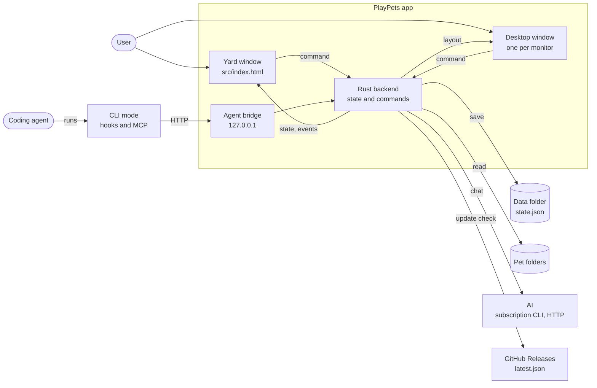

# Architecture: PlayPets app

## Scope
- The current structure of one PlayPets app install:
  - the yard window, the desktop overlay windows and the Rust backend
  - the files the app reads and writes
  - the outside touchpoints: AI, coding agents, GitHub Releases
- Elsewhere:
  - Agent integration commands and HTTP spec: [Architecture: coding agent integration](agent-integration.md).
  - Pet file format: [Pet file format standard](standards/pet-files.md).
  - Building and distribution: [release procedure](how-to/release.md).

## Diagram
A container-level diagram: the three parts inside the app and the touchpoints outside it.

## Components
| Component | Location | Responsibility |
|---|---|---|
| Yard window | `src/index.html`, `src/app.js`, `src/yard/`, `src/panel/`, `src/core/`, `src/styles/` | Draws the scenery and friends. Opens the side panel (Friend and Invite, beside the yard); Settings opens as a sheet over the yard. ES modules the browser reads with no build tool |
| Yard content | `src/content/catalog.json`, `src/content/yard.json`, `src/content/events.json`, `src/content/worlds.json`, `src/art/` | What the yard is made of, apart from the code ([details](#yard-content)) |
| Yard life | `src/yard/` | The backdrop, friends, trips, features and the frame loop ([details](#yard-life)) |
| Desktop window | `src/overlay.html`, `src/overlay/` | One transparent window per monitor. Draws friends where the backend places them and reports presses and drags |
| Commands | `src-tauri/src/commands.rs` | The single command the page calls (`call`) and the `COMMANDS` table: one row per name, saying which windows may ask for it and what it does. The page's bridge, the access check and the dispatch all come from that table ([how to add one](how-to/add-a-command.md)) |
| App state | `src-tauri/src/app.rs`; loading in `app/load.rs`, the person's switches in `app/prefs.rs`, sprites in `app/sprite.rs` | `AppData`, loading and saving, announcing changes to every window, serving sprites ([details](#app-state)) |
| Chat | `src-tauri/src/chat/` | Chat with one friend or several together: CLI sessions, HTTP AI, prompts ([details](#chat)) |
| Pets | `src-tauri/src/pets/` | Starter pets, pet folders, community import, friends, and the rules of the garden, album and closeness ([details](#pets)) |
| Agent | `src-tauri/src/agent/` | The CLI mode of the same executable (hooks, MCP, status commands) and the local HTTP bridge inside the app. The agent list is one table in `kinds.rs`; the settings snippets to paste are in `snippets.rs` |
| Desktop | `src-tauri/src/desktop/` | Opens and closes the overlay windows, computes friends' strolls and drags, and makes a window take clicks only while the cursor is over a friend |
| Windows, tray, menus, OS open | `window.rs`, `tray.rs`, `menu.rs`, `system.rs` | The yard window, the tray menu, the macOS menu bar, opening folders and addresses through the OS ([details](#windows-tray-menus-os-open)) |
| Strings | `src-tauri/src/i18n/<language>.rs`, `src/core/strings/<language>.js` | Per-language sentence tables. Registered in `i18n/mod.rs` and `core/strings.js` |
| Import links | `src-tauri/src/links.rs` | Takes `playpets://import?url=…`, imports the pet through the same path as a pasted address, and opens the Invite tab |
| Saved files | `src-tauri/src/store.rs` | Reads and writes the JSON files in the data folder atomically. A file that cannot be parsed is kept as a timestamped copy beside it (`state.json.corrupt-…`), so nothing is lost |
| Auto-update | `src-tauri/src/update.rs` | Checks `latest.json` on the latest release, renames the tray's update item once a version is found, reports download, signature-check and install stages (`update-status`), then restarts ([update notice](#update-notice)) |

### Yard content
- Every kind: fish, bugs, flowers, gifts, the garden's stages.
- The scenery's composition: curves, field, lake, layers.
- The seasonal events and the drawings.
- Loaded at start by `src/yard/content.js`.
- The backend has the catalogue built in (`pets/content.rs`).
- [How to add](how-to/add-to-the-yard.md), [design](design/2026-10-10-yard-content-as-data.md).

### Yard life
| Part | Files in `src/yard/` |
|---|---|
| The painted backdrop: painted only when the light, the season or the size changes, layer by layer as the composition lists them ([design](design/2026-10-09-a-painted-yard.md)) | `brush.js`, `palette.js`, `layout.js`, `trees.js`, `lake.js`, `clouds.js`, `backdrop.js` with its painters, `easel.js` |
| The lake's shape, shared by the painter and fishing (`catch.js`) | `lakeShape` in `layout.js` |
| Drawings, gift effects | `art.js`, `effects.js` |
| The field and its sizes | `field.js` |
| The scene now | `world.js` |
| What friends say on their own | `remarks.js` |
| Props on the field | `props.js` |
| The weather canvas | `scenery.js` |
| The scene and the clock | `sky.js`, `scene.js` |
| Friends as they stand: each friend is a body among the garden's plants and gifts, ordered by depth, and a label (bubble, name tag, agent dot) in a layer above everything on the field | `views.js` |
| One frame of a friend's life | `motion.js` |
| Trips and tasks (below) | `trips.js` |
| Work on the ground (below) | `work.js` |
| The hint read to screen readers; the visible one is the tool strip's | `hint.js`; which hint is the pure `hintKey` and `busyLine` |
| The first screen of an empty yard | `welcome.js` |
| Seasonal events | `events.js` holds their rules, `festival.js` shows them |
| Treats and games | `care.js`, `play.js`, `games.js`, `wander.js` |
| The garden and gifts | `garden.js`, `growth.js`, `decor.js` |
| Fishing and bugs | `catch.js`, `catalog.js`, `creatures.js`, `card.js` |
| Closeness | `bond.js` |
| The yard's sounds ([design](design/2026-10-10-yard-sounds.md)) | `sound.js`, `soundmix.js`, `soundscape.js` |

Trips and tasks (`trips.js`):
- `sendTo`/`release`: a friend's trip.
- `setDoing`: what it does where it stands.
- Also `isFree`, `nearestFree`, `rest`.
- Each belongs to whoever started it, so anything that takes over the friend ends them.

Work on the ground (`work.js`):
- Digging and planting send a friend so its held tool meets the spot.
- They hold it still while it works, then let it go.

The frame loop and shared tables:
- `app.js` runs the frame loop and calls each feature's tick in a fixed order (`YARD_LIFE` between games).
- `app.js` sends each backend event to its handler from one table (`ON_EVENT`).
- Keyboard shortcuts are one table in `core/keys.js`, the same keys as the macOS menu bar (`menu.rs`).
- `keys.test.mjs` keeps the two in sync.
- Occasional work uses `cadence`; work that follows the clock uses `everyMinute`. Both come from `core/ticker.js`.
- The limits the page shows before the backend's state arrives live in `core/limits.js`, with the same values as `pets::limits()`.

### App state
`AppData` holds:
- friends, the pet list, AI connections
- the switches in `Prefs`: desktop, roaming, language, chatter, sound, the window bounds and the Always on top setting. Each is one field, with one line to read it back and one to write it.
- conversations and answers still arriving, in `chat::Talks`
- status
- the garden (`pets/garden.rs`), the album (`pets/album.rs`), closeness (`pets/bond.rs`)

Saving and announcing:
- A command that changes the state goes through `commit`, which saves and announces once.
- A change made in place uses `save_and_show`.
- A change that could not be saved still takes effect and is shown.

Locks:
- The state is taken with `app::lock`, every other mutex with `app::hold`.
- Both accept a poisoned lock as is ([backend locks](standards/backend-locks.md)).

Parked entries:
- Saved friends whose pet file was not found at this start are parked (`AppData.parked_pets`).
  - They are not shown, and are written back as they were, with their closeness.
  - They return once the file does.
- Connections this version cannot read are parked the same way (`parked_providers`).

Days:
- Days the page sends are checked against the latest date that has begun anywhere on Earth (`pets::latest_day`, `has_come`).
- A day saved from a clock set ahead is forgotten at start (`forget_days_after`), so it cannot hold back the days after.

Format:
- `state.json` carries a format number (`schema`).
- When an older version opens a file from a newer one, it keeps a copy and preserves unknown keys and connections as they are.
- A carried key never replaces one this version writes.

### Chat
- Chat with one friend or several together.
- Keeps Claude CLI sessions alive and runs the Codex CLI. In `cli/`:
  - `mod.rs`: the session manager
  - `launch.rs`: starting a CLI
  - `claude.rs`, `codex.rs`: each CLI
- A stopped CLI ends with every process it started: a process group on Unix, a job object on Windows.
- Also handles HTTP AI and prompts.
- Everything that differs per AI kind (request and response shape, key rules, default address) is one table in `kind.rs`.

### Pets
- Unpacks the starter pets bundled with the app.
- Reads and checks pet folders, in one place (`catalog.rs`).
- Imports from community pages (`importer/`): trusted adapters in `sites.rs`, ordered discovery links in `src/content/communities.json`.
- Creates and edits friends.
- Keeps the rules of the garden and its gifts (`garden.rs`), the album (`album.rs`) and closeness (`bond.rs`), so the page cannot hand out seeds, catches or points of its own.

### Windows, tray, menus, OS open
- One frameless, freely resizable yard window, 300 × 210 minimum.
  - Bounds are saved as `windowRect`, pin state as `alwaysOnTop`.
  - Legacy `miniRect` is read only as a migration fallback.
- The tray menu, rebuilt from the state on every change:
  - check-marked switches that appear only when they apply
  - a mark on the icon when a coding agent waits
- The macOS menu bar. One handler, `menu::act`, serves both the menu bar and the tray.
- Opens folders and addresses through the OS.

### Update notice
- The main page shows an available update before the place selector in the yard dock.
- Installation starts from its dialog.
- Before handing control to the platform installer, the page records the source and target version in local storage (`update-restart`).
- After bootstrap, it consumes that record and shows one timed notice, but only if the running version matches the target.
- A failed installation clears the record.
- An ordinary restart never claims an update succeeded.

## Places, artwork and friend identity

### Places
`src/content/worlds.json` defines four built-in places:

| Place | ID |
|---|---|
| Hill garden | `woodland` |
| Stone courtyard | `courtyard` |
| Lakeside cottage | `lakeside` |
| Cozy living room | `studio` |

- Each describes its activity capabilities, floor and pond geometry, lighting images and window panes.
- `yard/environment.js` paints the accepted raster backdrop. `easel.js` keeps the procedural loading/error fallback.
- `weatherPanes` clips indoor rain, snow and overcast shading to the authored windows.
- Outdoor places support fishing and bugs.
- The living room keeps friends, garden, gifts and games, without those outdoor activities.
- Changing places ends active trips and games rather than transferring their old geometry.
- Imported background packages use the same capability and geometry contract.

### Time, weather and seasons
- With Auto selected, `yard/scene.js` follows the local clock for time of day.
- Automatic weather: a simulated choice per 20-minute block, with snow only in winter.
- It does not fetch local forecasts or geolocation.
- Automatic seasons: the local calendar and an approximate hemisphere inferred from the system time zone, or the person's override.
- New yards start in spring daylight with clear weather.
- Saved choices, including Auto, stay unchanged.
- The yard and overlay share that choice through local storage.
- Festivals keep their calendar dates even when the visible season is overridden.

### Friend identity
- The four bundled identities: Daisy, Clover, Pip and Miso.
- Retired app-owned appearances map to them:
  - Aria → Daisy
  - Noah → Pip
  - the original cats → Clover, before restoration
- Friend IDs, names, settings and closeness stay unchanged.
- Imported pets are not matched by this path-based migration.
- Old unpacked directories stay on disk but are excluded from the built-in catalog.
- The catalog checks the optional baseline `portraitPath`, seasonal sheets and the legacy alternate-appearance fields, and serves them through the same sprite protocol.
- A selected appearance changes drawing material, not the relationship or the AI connection.
- Full contract: [Pet file format](standards/pet-files.md).

## Data flow
What each arrow in the diagram carries, path by path.

1. **Page commands:**
   - The page calls something like `window.playPets.addPet(id)`, and Tauri passes it to `commands::call`.
   - `call` checks that the calling window may use that command (the overlay may use only five), then handles it on a worker thread.
   - The handler changes `AppData` inside the app state lock and saves to `state.json`.
   - The result is `{ok, data}` or `{ok: false, error}`.
   - The error sentence is already in the current language.
2. **State notifications:**
   - On a state change, `app::changed` builds the full state for the page and sends it to every window as `__pp('change', state)`. The page redraws.
   - Things that happen once (speech bubbles, reactions, chat arrivals, window hidden, new version) are sent separately as `__pp('event', …)`.
3. **Sprites:**
   - The page's image address is `pet-asset://sprite/<pet id>` (on Windows, `http://pet-asset.localhost/sprite/<pet id>`).
   - The backend reads the file on a worker thread and returns it.
   - The response carries a CORS allow header, because the page reads pixels to measure the empty rows at the top of each cell.
4. **Agent status:**
   - A coding agent's hook runs `playpets hook claude`: the same executable in CLI mode, with no window.
   - It turns the hook payload into a state and a code (`@tool Bash`).
   - It reads the port and token from `bridge.json` in the data folder and sends them to the app's bridge.
   - The app turns the code into a sentence in the current language and shows it above the friend.
   - The app remembers it as recent activity, used when answering "what were you doing?".
5. **Chat:**
   - The page calls `chat`. The backend looks at the friend's AI connection and asks one of:
     - the Claude CLI (a long-lived session per friend)
     - the Codex CLI (one run per message)
     - an HTTP AI
   - API keys are read from the OS secure storage after the lock is released.
   - Answers stay in the in-memory chat log (the latest 500 per friend, shown by `getChat`) and reach the page as a `chat-message` event.
   - A friend is handed only the latest 24 of its log when it answers; a live Claude CLI session also keeps what it was told before.
   - Chat history is not saved to a file.
6. **Desktop:**
   - The overlay thread reads the cursor every 40 ms while moving and every 120 ms while quiet.
   - Each read advances strolls and drags by one step.
   - Only the monitor window with the cursor over a friend takes clicks.
   - When a friend moves, the thread sends the layout to that monitor's window.
   - When the cursor enters or leaves a friend, a `hover` event tells the windows which friend shows its name button.
   - A friend belongs to the monitor whose work area holds the centre of its box.
   - Resting positions are batched and saved within 2 seconds.
7. **Update:**
   - When: 20 seconds after start (except in dev builds and E2E), or from the button in Settings.
   - The app reads `latest.json` from the latest GitHub release and tells the page about a new version.
   - When a person presses install: download, verify the signature with the public key, install, restart.

## Interfaces
| Touchpoint | Source | Summary |
|---|---|---|
| Page → backend commands | The `COMMANDS` table in `src-tauri/src/commands.rs` (see Commands in [Components](#components)) | [Commands by area](#commands-by-area). The overlay gets only `bootstrap`, `play`, `openChat`, `dragStart`, `dragStop` |
| Backend → page | `app::changed`, `app::push_event` | `change` (full state), `event` (status, say, play, chat-message, select, window, update, update-status, check-update, open-panel, persona-saved, history-reset, import-request, pet-moved) |
| Sprites | `app::sprite_response` | The `pet-asset` custom protocol |
| Coding agents | [Architecture: coding agent integration](agent-integration.md) | CLI commands, hooks, MCP, HTTP bridge |

### Commands by area
| Area | Commands |
|---|---|
| Friends | `addPet`, `updatePet`, `removePet`, `play` |
| Pet files | `importUrl`, `importFolder`, `openFolder` |
| AI and chat | `saveProvider`, `chat`, `chatWith` |
| Yard chatter | `chatter`, `setAutoChatter` |
| Yard sounds | `setSound` |
| The garden and its gifts | `plant`, `pullPlant`, `receiveGift`, `moveDecor`, `putAway` |
| Discoveries and trees | `dig`, `plantTree`, `moveTree`, `removeTree`, `growTrees` |
| The album | `catch`, `bloomed` |
| Closeness | `befriend` |
| Copying agent settings, choosing which friend an agent reports to | `copyConnection`, `assignAgent` |
| Also | Desktop and windows, language, update, quit |

## Environment and touchpoints
- The app data folder is named after the app identifier `app.playpets`.
- The identifier does not change after release.

| OS | Data folder |
|---|---|
| macOS | `~/Library/Application Support/app.playpets/` |
| Windows | `%APPDATA%\app.playpets\` (the package virtualization path when installed through MSIX) |
| Linux | `$XDG_DATA_HOME` or `~/.local/share/app.playpets/` |

| In the data folder | Holds |
|---|---|
| `state.json` | Friends, settings, AI connections, the garden and its gifts, the album, closeness, friends and connections parked from an earlier start, the yard sounds' setting, the window bounds and Always on top setting |
| `bridge.json` | The agent bridge's port and token. Both change on every launch |
| `pets/` | Pets imported from an address |
| `builtin/` | The four illustrated starter entries bundled in the executable, unpacked at launch |

- API keys are not in this folder. They are in the OS secure storage.

| Environment variable | Use |
|---|---|
| `PLAYPETS_DATA` | Changes the data folder (E2E, measurement) |
| `CODEX_HOME` | Changes the Codex pet folder (`<value>/pets`) |
| `PLAYPETS_LANG` | Pins the language to one of `ko`, `en`, `ja`, `zh-hans` |
| `PLAYPETS_E2E_EVAL` | The E2E scenario script. Runs 3 seconds after the page loads. Honored only by the `e2e` build (below) |
| `PLAYPETS_BRIDGE`, `PLAYPETS_PET` | The `bridge.json` path and default friend for CLI mode |
| `PLAYPETS_DEBUG` | Makes `playpets hook …` print to standard error why it could not reach the app. Without it, a hook stays silent |
| `WEBKIT_DISABLE_DMABUF_RENDERER` | Linux: WebKitGTK's renderer switch (below) |
| `PLAYPETS_BINARY` | The executable E2E, captures and measurement launch. Default `src-tauri/target/e2e/playpets`; the `build` workflow points it at the `target/release` build |

The `e2e` build (`cargo build --profile e2e --features e2e`):
- Writes `src-tauri/target/e2e/`, so it never replaces the app in `target/release/`.
- Turns off single-instance, deep-link registration and the start-at-login plugin (the switch only pretends).
- Turns on the `test_only` rows of `COMMANDS`: `e2eLog`, `e2eWindow`, `e2eTray`, `e2eFreshGifts`.
- Skips the update check.

`WEBKIT_DISABLE_DMABUF_RENDERER` on Linux:
- The app sets it to `1` at start when it is unset, because the DMA-BUF renderer leaves a blank window without a usable GPU.
- The browser or file manager the app opens starts without it.
- A value that is already set is kept and passed on.

Start at login:
- The system starts the app at login with `--autostart` (`tauri-plugin-autostart`): a LaunchAgent on macOS, the Run key on Windows, an autostart entry on Linux.
- Started that way with desktop mode on, the yard window stays hidden.

The yard window:
- Frameless on every OS.
- A narrow transparent target along the top edge moves the window without reserving title-bar space.
- Edges and corners resize it.
- Small sizes use responsive layouts in the same window.
- Always on top: the shared yard and right-click menu, the tray and the macOS menu bar each toggle it, independent of size.
- Cmd/Ctrl+Shift+M toggles Always on top without resizing.
- Fullscreen: the shared menu enters it and returns to the previous size.
- Esc leaves fullscreen once open menus and dialogs are closed.
- Fullscreen preserves the previous window bounds and Always on top setting for restoration.
- The menu can hide the yard to the tray.
- Native close requests also hide the window instead of quitting.

What differs per OS:

| OS | Differences |
|---|---|
| macOS | The overlay becomes an NSPanel, so it shows even over other apps' full screen. The original class is restored before closing; without that the app crashes. Closing the yard also hides the Dock icon. The menu bar exists only on macOS |
| Windows | CLI child processes get no console window. A `claude.cmd` installed through npm runs directly as node plus the script (a `.cmd` cannot take arguments that contain line breaks). Folders and addresses open through ShellExecuteW. Cursor coordinates are converted with the scale of the monitor under the cursor. Installed through MSIX, the agent settings point at the execution alias `playpets.exe` |
| Linux | Distributed as deb and AppImage. E2E runs on Xvfb |

## Related decisions
- "[The backend is split into folders by role, and main.rs only wires things up](decisions/2026-09-30-backend-modules-by-role.md)"
- "[Page modules run nothing on import and do not import each other in cycles](decisions/2026-09-30-page-modules-run-nothing-on-import.md)"
- "[Never wait on the main thread while holding the app state lock](decisions/2026-09-30-no-waiting-on-main-thread-under-state-lock.md)"
- "[The page draws often only when something moves, and drawing loops run on timers](decisions/2026-09-30-timer-frame-loops.md)"
- "[Strings live in two per-language tables, one for the page and one for the backend, and agent status is sent as codes](decisions/2026-09-30-strings-in-two-tables.md)"
- "[GitHub releases are the source, auto-update, winget and a Homebrew tap point at those files, and code signing turns on with secrets](decisions/2026-10-01-distribution-channels-and-signing.md)"
- "[Real-app E2E runs a scenario script inside the app](decisions/2026-09-29-e2e-inside-the-real-app.md)"

## Change history
- 2026-09-29 Moved from Electron to a single Tauri v2 shell. The web page is in `src/`, the backend in `src-tauri/`
- 2026-09-30 Split the backend into folders by role. Added Korean, English and Japanese. Switched the page loops to timers and set the lock rule
- 2026-10-01 Added auto-update and distribution channels (winget, Homebrew tap)
- 2026-10-05 Bundled the three starter pets in the executable and unpacked them into the data folder (`pets/builtin.rs`), and added the import link scheme
- 2026-10-06 Added Simplified Chinese as the fourth language, relationships between a friend and the person, and yard chatter (friends talking among themselves, on a button or a timer)
- 2026-10-09 The painted yard, the garden, gifts, fishing and bugs, and the album; the yard fills its frame and Settings opens as a sheet over it
- 2026-10-10 The yard's content as data (catalogue, composition, drawings, effects); field.js, world.js, remarks.js and props.js split out
- 2026-10-10 Closeness, the yard's sounds, one way to send a friend somewhere (`sendTo`), and one way to save and announce a change in the backend (`app::commit`)
- 2026-10-10 Commands, state and chat:
  - one `COMMANDS` table for every command
  - `app.rs` split into `app/load.rs` and `app/sprite.rs`
  - `trips.js` and `hint.js` split out of the views
  - parked friends; closeness levels and relationship voices
  - one cancel flag per chat; `app::hold` for every lock but the state
  - the chat CLIs run in a private working folder and get the system prompt from a file there (Claude Code) or standard input (Codex), not the command line
  - another friend's words kept to one line
